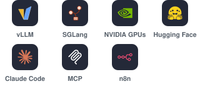

<p align="center">
  
</p>

<p align="center">
  <a href="https://linkedin.com/in/matanweisz"></a>
  
</p>

## About me

Hello, my name is Matan and I'm a DevOps Engineer from Israel.

I build and run cloud infrastructure, Kubernetes clusters, Terraform projects and CI/CD pipelines.
Lately most of my curiosity goes to the infrastructure behind AI. I love digging into how it really works: what happens between a prompt and a response, and the best practices that let so many people use AI without ever noticing the complex systems behind it.

I do my best work as part of a strong team. I like digging into an incident together, giving and getting honest code reviews, and celebrating the deploys that turn out boring. I'm happy to be the teammate people can ask anything, and I ask plenty back.

Before tech, I was a Company Sergeant Major in the IDF's Duvdevan unit. Leading a team under pressure turned out to be good training for production incidents.

### Human as code: `matan.yaml`

```yaml
apiVersion: v1
kind: Engineer
metadata:
  name: matan-weisz
  location: herzliya-israel
spec:
  craft: [kubernetes, terraform, gitops, aws, gcp]
  goingDeepOn: [llm-inference, gpu-platforms, ai-gateways, ai-agents]
  bestWith: [strong-teams, honest-code-reviews, blameless-postmortems]
  believesIn:
    - automate the boring parts first
    - if it can't be rebuilt from code, it isn't done
    - small changes, shipped often, easy to roll back
status:
  phase: Running
  openTo: [devops, platform, sre, ai-infrastructure]
```

## Skills and Tools

<table width="100%">
  <tr>
    <td width="50%" valign="top">
      <h4>AI and LLM infrastructure</h4>
      <br/>
      <sub>Model serving · LLM gateways · LLM APIs · AI agents</sub>
    </td>
    <td width="50%" valign="top">
      <h4>Containers and Kubernetes</h4>
      <br/>
      <sub>EKS · GKE · Docker Compose</sub>
    </td>
  </tr>
  <tr>
    <td valign="top">
      <h4>Cloud</h4>
      <br/>
      <sub>EKS · EC2 · S3 · IAM · VPC · GKE · GCP Fleets · Shared VPC</sub>
    </td>
    <td valign="top">
      <h4>Infrastructure as code</h4>
      <br/>
      <sub>Modules · remote state · multi-environment setups</sub>
    </td>
  </tr>
  <tr>
    <td valign="top">
      <h4>CI/CD and GitOps</h4>
      
    </td>
    <td valign="top">
      <h4>Observability</h4>
      
    </td>
  </tr>
  <tr>
    <td valign="top">
      <h4>Code and foundations</h4>
      <br/>
      <sub>Automation scripts · networking</sub>
    </td>
    <td valign="top">
      <h4>Apps, APIs and data</h4>
      
    </td>
  </tr>
</table>

<p align="center"><sub>Always happy to talk infrastructure, AI or a good postmortem. <a href="https://linkedin.com/in/matanweisz">Find me on LinkedIn</a>.</sub></p>
