  

  
   
  Herzliya, Israel · open to DevOps, platform, SRE and AI infrastructure roles

I'm a DevOps and cloud infrastructure engineer. I run Kubernetes in production, write the infrastructure as code, and automate the work around it. At ZoomInfo I operated hundreds of Kubernetes clusters on AWS and GCP. Now I'm going deeper where infrastructure meets AI: serving open models on Kubernetes, GPUs, and the platforms that let teams use LLMs safely and at a cost they can see.

### What I've worked on

- **Kubernetes at scale, ZoomInfo.** Operated hundreds of EKS and GKE clusters day to day, all managed as code in Terraform. Moved administration of hundreds of GKE clusters to GCP Fleets, which gave the company one automated, consistent way to manage them.
- **AI Gateway, ZoomInfo.** Worked on the company's central AI Gateway, through which hundreds of internal services and employees use internal and third-party LLMs, with access control and usage tracking in one place.
- **AI root-cause helper for CI/CD, Infinity Labs.** Designed and built a proof of concept on n8n, LLM APIs and MCP tools that reads the logs of failed pipelines and points developers to the root cause. Other departments then adopted the n8n platform I deployed.
- **GitOps and infrastructure as code, Infinity Labs.** Built CI/CD pipelines and GitOps deployments with Argo CD, worked on moving legacy cloud infrastructure to Terraform, and mentored DevOps students from theory to a simulated production deployment.

### What I'm building now

**A self-hosted LLM platform on Kubernetes**, built in stages: open models served with vLLM on a GPU, an internal AI gateway with per-team keys, budgets and fallback, a Go operator for self-service model deployment, then GPUs on EKS that scale from zero, eval-gated rollouts and a verified supply chain. I'll publish each stage once it works.

I also build my own tools. My daily driver is a personal app (FastAPI and React, installable on my phone) that plans my learning and job search, deploys itself on every merge and rolls back on a failed health check.

### Where I'm heading

AI platform and LLMOps engineering: LLM inference and GPU scheduling on Kubernetes, AI gateways and cost control, and evals as a release gate. Open to roles in Israel or remote.

### Toolbox

| Area | Tools |
|---|---|
| **Cloud** | AWS (EKS, EC2, S3, IAM, VPC), GCP (GKE, Fleets, Shared VPC) |
| **Kubernetes** | Kubernetes, Helm, Docker, Argo CD, Crossplane |
| **IaC and CI/CD** | Terraform, GitLab CI, GitHub Actions, Jenkins |
| **Observability** | Prometheus, Grafana, Loki |
| **Code and AI** | Python, Bash, LLM APIs, MCP, n8n |

### Before tech

Company Sergeant Major in the IDF's Duvdevan unit: responsible for soldiers, equipment and readiness, and led teams on missions at short notice. Later volunteered as an Israeli emissary for The Jewish Agency. AWS Certified Cloud Practitioner.
