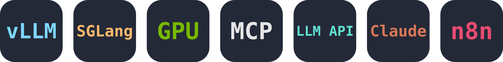

<p align="center">
  
</p>

<p align="center">
  <a href="https://linkedin.com/in/matanweisz"></a>
  
  
</p>

## About me

Hey, I'm Matan, a DevOps engineer from Israel.

I build and run cloud infrastructure: Kubernetes clusters, Terraform, and pipelines that ship code without anyone having to babysit them. Good infrastructure is the kind nobody has to think about, and that's what I aim for.

Lately most of my curiosity goes to the infrastructure behind AI. I want to know how a model goes from a file on disk to a fast, reliable API, and how a company can let every team use LLMs safely without losing track of the bill.

Before tech, I was a Company Sergeant Major in the IDF's Duvdevan unit. Leading a team under pressure turned out to be good training for production incidents.

### If I were a Kubernetes resource

```yaml
apiVersion: v1
kind: Engineer
metadata:
  name: matan-weisz
  location: herzliya-israel
spec:
  craft: [kubernetes, terraform, gitops, aws, gcp]
  goingDeepOn: [llm-inference, gpu-platforms, ai-gateways, ai-agents]
  believesIn:
    - automate the boring parts first
    - if it can't be rebuilt from code, it isn't done
    - small changes, shipped often, easy to roll back
status:
  phase: Running
  openTo: [devops, platform, sre, ai-infrastructure]
```

## What I work on

<table>
  <tr>
    <td width="50%" valign="top">
      <h4>Kubernetes platforms</h4>
      I run Kubernetes clusters and make them easy for developers to use, so teams can ship without worrying about servers.
    </td>
    <td width="50%" valign="top">
      <h4>Infrastructure as code</h4>
      All cloud resources live in Terraform and Git. Any environment can be rebuilt from scratch with one command.
    </td>
  </tr>
  <tr>
    <td valign="top">
      <h4>CI/CD and GitOps</h4>
      Pipelines that test and deploy automatically, with Argo CD keeping every cluster in sync with Git.
    </td>
    <td valign="top">
      <h4>AI infrastructure</h4>
      Running AI models on Kubernetes and GPUs, and giving teams one simple, safe way to use LLMs.
    </td>
  </tr>
</table>

## Skills and tools

<table width="100%">
  <tr>
    <td width="50%" valign="top">
      <h4>AI and LLM infrastructure</h4>
      <br/>
      <sub>Model serving · GPUs on Kubernetes · LLM gateways · AI agents</sub>
    </td>
    <td width="50%" valign="top">
      <h4>Containers and Kubernetes</h4>
      <br/>
      <sub>EKS · GKE · Helm · Crossplane</sub>
    </td>
  </tr>
  <tr>
    <td valign="top">
      <h4>Cloud</h4>
      <br/>
      <sub>EC2 · S3 · IAM · VPC · GCP Fleets · Shared VPC</sub>
    </td>
    <td valign="top">
      <h4>Infrastructure as code</h4>
      <br/>
      <sub>Modules · multi-environment setups · Crossplane</sub>
    </td>
  </tr>
  <tr>
    <td valign="top">
      <h4>CI/CD and GitOps</h4>
      <br/>
      <sub>Argo CD · GitOps workflows</sub>
    </td>
    <td valign="top">
      <h4>Observability</h4>
      <br/>
      <sub>Loki · Mimir · Alloy</sub>
    </td>
  </tr>
  <tr>
    <td valign="top">
      <h4>Code and foundations</h4>
      <br/>
      <sub>Automation scripts · networking</sub>
    </td>
    <td valign="top">
      <h4>Apps and tools I build</h4>
      <br/>
      <sub>Internal tools · mobile-friendly web apps</sub>
    </td>
  </tr>
</table>

<p align="center"><sub>Always happy to talk infrastructure, AI or a good postmortem. <a href="https://linkedin.com/in/matanweisz">Find me on LinkedIn</a>.</sub></p>
