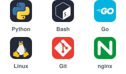
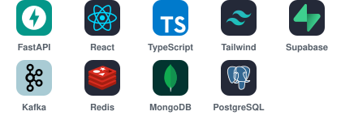

<p align="center">
  
</p>

<p align="center">
  <a href="https://linkedin.com/in/matanweisz"></a>
  
  
</p>

## About me

Hey, I'm Matan, a DevOps engineer from Israel.

I build and run cloud infrastructure: Kubernetes clusters, Terraform, and pipelines that ship code without anyone having to babysit them. Good infrastructure is the kind nobody has to think about, and that's what I aim for.

Lately most of my curiosity goes to the infrastructure behind AI. I want to know how a model goes from a file on disk to a fast, reliable API, and how a company can let every team use LLMs safely without losing track of the bill.

I do my best work as part of a strong team. I like digging into an incident together, giving and getting honest code reviews, and celebrating the deploys that turn out boring. I'm happy to be the teammate people can ask anything, and I ask plenty back.

Before tech, I was a Company Sergeant Major in the IDF's Duvdevan unit. Leading a team under pressure turned out to be good training for production incidents.

### Human as code: `matan.yaml`

```yaml
apiVersion: v1
kind: Engineer
metadata:
  name: matan-weisz
  location: herzliya-israel
spec:
  craft: [kubernetes, terraform, gitops, aws, gcp]
  goingDeepOn: [llm-inference, gpu-platforms, ai-gateways, ai-agents]
  bestWith: [strong-teams, honest-code-reviews, blameless-postmortems]
  believesIn:
    - automate the boring parts first
    - if it can't be rebuilt from code, it isn't done
    - small changes, shipped often, easy to roll back
status:
  phase: Running
  openTo: [devops, platform, sre, ai-infrastructure]
```

## My playbook

<table>
  <tr>
    <td width="50%" valign="top">
      <h4>Kubernetes platforms</h4>
      <i>Clusters developers enjoy using.</i>
      <ul>
        <li>Every workload ships with requests, limits and health probes.</li>
        <li>Least-privilege access and network policies by default.</li>
        <li>Upgrade early and often, so upgrades stay boring.</li>
      </ul>
    </td>
    <td width="50%" valign="top">
      <h4>Infrastructure as code</h4>
      <i>If it exists in the cloud, it exists in Git.</i>
      <ul>
        <li>Remote state with locking, and small modules that get reused.</li>
        <li>Every change gets a reviewed plan before it's applied.</li>
        <li>ClickOps is a bug.</li>
      </ul>
    </td>
  </tr>
  <tr>
    <td valign="top">
      <h4>CI/CD and GitOps</h4>
      <i>Merging is the deploy.</i>
      <ul>
        <li>Argo CD keeps every cluster in sync with Git and corrects drift on its own.</li>
        <li>Short-lived OIDC credentials instead of stored cloud keys.</li>
        <li>Canary releases that roll back by themselves when the numbers look bad.</li>
      </ul>
    </td>
    <td valign="top">
      <h4>Observability and reliability</h4>
      <i>Know something's wrong before the users do.</i>
      <ul>
        <li>Alerts on what users actually feel, measured against SLOs.</li>
        <li>Dashboards that answer a question someone really asks.</li>
        <li>Blameless postmortems that end with a fix, and a runbook.</li>
      </ul>
    </td>
  </tr>
  <tr>
    <td colspan="2" valign="top">
      <h4>AI infrastructure</h4>
      <i>Models and LLM features run like any other production service.</i>
      <ul>
        <li>Models and images pinned by digest, and prompts versioned like code.</li>
        <li>Evals run in CI, so a bad prompt change fails the build before it reaches a customer.</li>
        <li>One gateway for every team's keys, budgets and provider fallback.</li>
        <li>GPUs scale to zero when nobody's calling, and every token has a known cost.</li>
      </ul>
    </td>
  </tr>
</table>

## Where I'm heading

I want to work on AI platform teams: the people who make it easy for a whole company to build with AI. That means serving models efficiently on GPUs, building gateways and self-service tools for developers, and making AI features as reliable as everything else in production.

Further down the road, I'd love to work hands-on with customers, helping them take AI from a demo to production.

## Skills and tools

<table width="100%">
  <tr>
    <td width="50%" valign="top">
      <h4>AI and LLM infrastructure</h4>
      <br/>
      <sub>Model serving · LLM gateways · LLM APIs · AI agents</sub>
    </td>
    <td width="50%" valign="top">
      <h4>Containers and Kubernetes</h4>
      <br/>
      <sub>EKS · GKE · Docker Compose</sub>
    </td>
  </tr>
  <tr>
    <td valign="top">
      <h4>Cloud</h4>
      <br/>
      <sub>EKS · EC2 · S3 · IAM · VPC · GKE · GCP Fleets · Shared VPC</sub>
    </td>
    <td valign="top">
      <h4>Infrastructure as code</h4>
      <br/>
      <sub>Modules · remote state · multi-environment setups</sub>
    </td>
  </tr>
  <tr>
    <td valign="top">
      <h4>CI/CD and GitOps</h4>
      
    </td>
    <td valign="top">
      <h4>Observability</h4>
      
    </td>
  </tr>
  <tr>
    <td valign="top">
      <h4>Code and foundations</h4>
      <br/>
      <sub>Automation scripts · networking</sub>
    </td>
    <td valign="top">
      <h4>Apps, APIs and data</h4>
      
    </td>
  </tr>
</table>

<p align="center"><sub>Always happy to talk infrastructure, AI or a good postmortem. <a href="https://linkedin.com/in/matanweisz">Find me on LinkedIn</a>.</sub></p>
